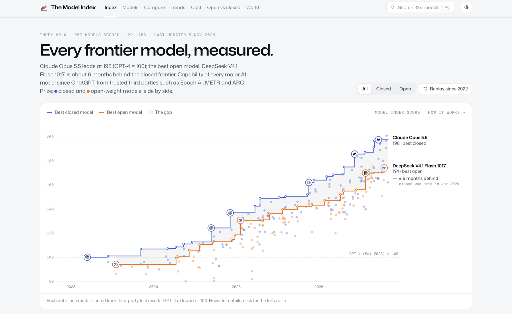

# Thato Tladi

Wrangling agents, making friends along the way, and trying to change the world, or at least my own communities.

### The Model Index

[themodelindex.org](https://themodelindex.org)

Every major AI model since ChatGPT, measured from third-party evidence: capability over time, open vs closed, price, releases from 22 labs, and who in the world can actually reach them. It covers every country and goes deepest on South Africa first. A pipeline checks the sources every 30 minutes and the site updates itself.

### Speech recognition for all 11 South African languages

I fine-tuned an open speech model on all 11 official languages for under $15 of GPU. Results and a leaderboard coming soon.

### Agents and inference

I'm really into agents, an aspiring agentic cowboy if you like. I love handing a fleet of them a problem that's too big for one person and seeing how far we get. My other rabbit hole is inference, making models run fast and cheap.

Most repos are private today. I've got a lot of cool open source projects I've been working on in the back, and I'll start pushing them up here soon. First fix merged upstream: [google/gvisor#15445](https://github.com/google/gvisor/pull/15445).

I write about AI and what it means for Africa on [LinkedIn](https://www.linkedin.com/in/thato-tladi-9001b827a/).
